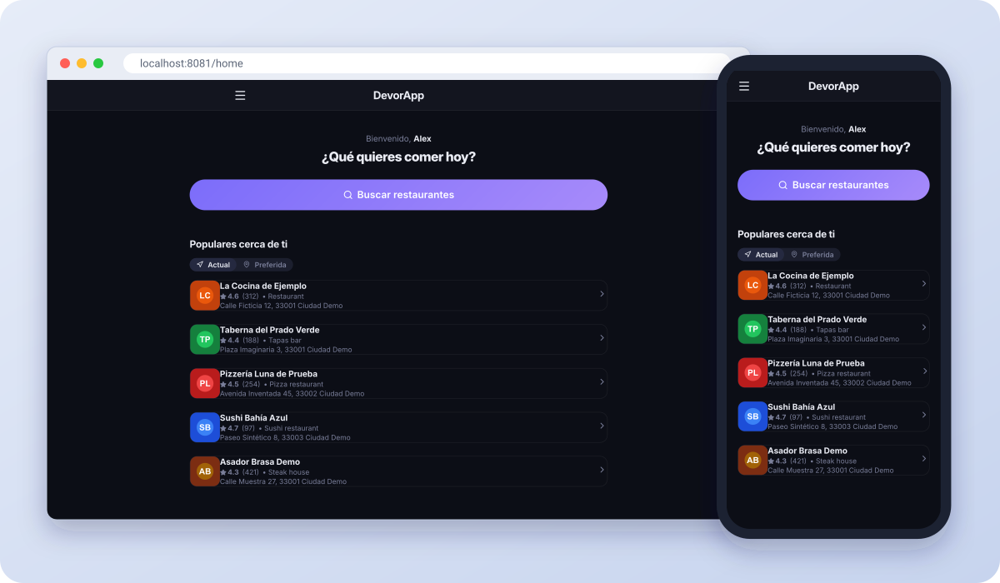

# giise2ebench-st-devorapp

[](https://github.com/augustocristian/giise2ebench-st-devorapp/actions/workflows/ci.yml) [](https://sonarcloud.io/summary/new_code?id=augustocristian_giise2ebench-st-devorapp) [](https://sonarcloud.io/summary/new_code?id=augustocristian_giise2ebench-st-devorapp)

<p align="center"></p>

## Structure

| Folder | Contents |
|---|---|
| [`sut/`](sut) | The DevorApp application (frontend, backend, keras-api) and the services that replace external ones in development: `gplaces-mock` and `firebase-emulator` |
| [`selenium-java/`](selenium-java) | E2E and API suite with Java + JUnit 5 + Selenium |
| [`cypress-js/`](cypress-js) | The same suite with JavaScript + Cypress |

Both suites cover the same scenarios and run against the system deployed in **dev** mode. The frontend also has its own network-mocked Playwright specs (see [Component tests](#component-tests)), which run in CI alongside them.

---

## Deployment

**The Docker images are built once and are the same in dev and prod.** The only differences between environments are the environment variables (and the files that are mounted) each container is started with:

| | **dev** | **prod** |
|---|---|---|
| Compose | `docker-compose.yml` + `docker-compose.dev.override.yml` | `docker-compose.yml` |
| Authentication and profiles | `firebase-emulator` (local) | Real Firebase project |
| Restaurants and geocoding | `gplaces-mock` (local, fixed fictitious dataset) | Real Google Places and Geocoding |
| Configuration | None: `docker-compose.dev.override.yml` itself supplies dummy values | `.env` files and Firebase credential |
| Data | Ephemeral (lost on `down -v`) | Persistent |

All commands run from the `sut/` folder. Requirements: Docker with Compose **2.24 or later**.

### Production

Requires real Firebase and Google Cloud accounts.

**1. Firebase** (Authentication + Firestore): create the project, enable the *Email/Password* provider, create the Firestore database, and download the service account key as `sut/backend/firebase-service-account.json` (it is mounted into the container and is **not** included in the image).

**2. Google Cloud**: enable *Places API (New)* and *Geocoding API*, and create an API key. For Google Sign-In, also create an OAuth client ID (see [`sut/README.md`](sut/README.md#11-google-sign-in-configuration-sign-in-with-google)).

**3. Create the three `.env` files** (they are in `.gitignore`):

`sut/backend/.env`

| Variable | Description |
|---|---|
| `FIREBASE_PROJECT_ID` | Firebase project ID |
| `FIREBASE_API_KEY` | Project *Web API Key* (password login) |
| `GOOGLE_API_KEY` | Google Places / Geocoding key |
| `GOOGLE_CLIENT_ID` | OAuth client ID (Google Sign-In) |
| `SECRET_KEY` | Secret used to sign JWTs. Generate your own: `openssl rand -hex 32` |
| `KERAS_API_KEY` | Key shared with the AI microservice (same as `API_KEY_RECOMMENDER`) |

`sut/keras-api/.env`

| Variable | Description |
|---|---|
| `API_KEY_RECOMMENDER` | Same key as the backend's `KERAS_API_KEY` |
| `GOOGLE_API_KEY` | Google Places key |
| `MODEL_PATH`, `PORT`, `DATABASE_URL` | Model path (`./models/modelo_prod.h5`), port (`8001`) and database (`postgresql://postgres:password@db:5432/tfg_db`) |

`sut/frontend/.env` (read **when the container starts**, not when the image is built)

| Variable | Description |
|---|---|
| `VITE_GOOGLE_CLIENT_ID` | OAuth client ID. Required: without it the application does not render |
| `VITE_GOOGLE_API_KEY` | Google Maps key (location autocomplete) |
| `VITE_API_URL` | Optional. Backend URL if it is not the same origin (`/api`) |

**4. Start:**

```bash
docker compose up -d --build
docker compose down            # stop (add -v to also delete the database)
```

The frontend is available at `http://localhost` (and `https://localhost`, with a self-signed certificate) and the backend at `http://localhost:8000`.

Production notes:
- The session cookie is `Secure` (`COOKIE_SECURE=true` by default), so the application must be served over **HTTPS** (behind a proxy with a valid certificate).
- Email verification is enabled (`SKIP_EMAIL_VERIFICATION=false`).
- On `main` and `v*` tags, CI publishes the images to `ghcr.io/<owner>/<repository>/{backend,frontend,keras-api}` tagged `<sha>`, `latest` and the version.

### Upgrading an existing deployment

This version renamed the API, the PostgreSQL schema and the Firestore profile data to English (see [API](#api)). It is a breaking change: update the backend, the frontend and any other client together, because the old routes no longer exist.

1. **PostgreSQL: automatic.** The backend container runs `alembic upgrade head` on start. The revision `a41c7e2f9b10_rename_spanish_schema_to_english` renames the tables and columns (for example `valoraciones` to `ratings`, `calidad` to `quality`) and keeps all the data. `alembic downgrade -1` reverses it.
2. **Firestore: run the script first.** User profiles moved from the collection `usuarios` (fields `nombre`, `apellidos`, `ubicacion`) to `users` (fields `first_name`, `last_name`, `location`). The new backend reads and writes only `users`, so migrate **before** deploying it:

```bash
cd sut/backend
python scripts/migrate_firestore_users.py --service-account path/to/firebase-service-account.json            # dry run (default): lists what would be copied
python scripts/migrate_firestore_users.py --service-account path/to/firebase-service-account.json --apply    # copy the documents
python scripts/migrate_firestore_users.py --service-account path/to/firebase-service-account.json --apply --delete-old   # optional, after checking: remove the old documents
```

The script is idempotent (documents already present in `users` are skipped) and also works against the emulator when `FIRESTORE_EMULATOR_HOST` is set. The dev stack starts empty, so it needs no migration.

### Development

```bash
docker compose -f docker-compose.yml -f docker-compose.dev.override.yml up -d --build
docker compose -f docker-compose.yml -f docker-compose.dev.override.yml down -v     # stop and delete the data
```

No account, key or `.env` file is needed. What this means:

- **Local services instead of the real ones:** `firebase-emulator` (Authentication and Firestore) and [`gplaces-mock`](sut/gplaces-mock/README.md) (Google Places and Geocoding with 13 fictitious places (12 restaurants and a pharmacy) in Gijón, Oviedo and Avilés). The data is artificial and stable, and can be reset with `curl -X POST http://localhost:8002/__admin/reset`.
- **Environment settings:** the backend starts with `SKIP_EMAIL_VERIFICATION=true` (there is no inbox) and `COOKIE_SECURE=false` (HTTP is used); the frontend receives a dummy Google client ID and key.
- **Limitations:** Google Sign-In does not work, and the browser's Google Maps SDK is not replaced (the tests simulate it).
- **Ports:** frontend `80`, backend `8000`, keras-api `8001`, `gplaces-mock` `8002`, PostgreSQL `5432`.
- **Hot reload** (optional, keeps the emulator and the mock): add `-f docker-compose.hotreload.yml`. The `deploy.ps1 -Dev` and `deploy.sh --dev` scripts do exactly this.

---

## API

The REST API is versioned: every route lives under `/api/v1` (interactive documentation at `/docs`, schema at `/openapi.json`, health check at `/health`). The old Spanish routes (`/api/favoritos`, `/api/historial`, `/api/mas-tarde`, `/api/valoraciones`, `/api/login`...) were removed without aliases.

| Area | Routes |
|---|---|
| Sessions and users | `POST /sessions` (log in), `DELETE /sessions/current` (log out), `POST /sessions/google`, `POST /users` (register), `POST /users/google`, `GET /users/availability`, `POST /password-resets`, `GET /email-verification?email=`, `GET /me`, `PATCH /profile`, `PATCH /profile/email`, `PATCH /profile/password`, `DELETE /profile` |
| Favorites | `GET/POST /favorites/lists`, `GET/PATCH/DELETE /favorites/lists/{list_id}`, `POST /favorites/lists/{list_id}/restaurants`, `DELETE /favorites/lists/{list_id}/restaurants/{favorite_id}` |
| History | `GET/POST /history`, `GET/DELETE /history/{entry_id}`, `GET /history/popular` |
| Saved for later | `GET/POST /saved-for-later`, `GET/DELETE /saved-for-later/{entry_id}` |
| Ratings | `PUT/GET/DELETE /restaurants/{place_id}/rating`, `GET /restaurants/{place_id}/ratings`, `GET /ratings`, `POST/DELETE /ratings/{rating_id}/likes` |
| Recommendations | `POST /recommendations/search` |

Conventions:

- **Status codes:** `201` with a `Location` header when a resource is created, `200` for reads and idempotent updates, `202` for accepted-but-asynchronous requests (password reset), `204` without a body for deletions, `409` for conflicts (duplicate email, username, list name), `422` for validation failures, `401`/`403`/`404` as usual.
- **Collections** of history, saved items and ratings are paginated: `?limit=` (default 50, maximum 100) and `?offset=`, answered as `{"items": [...], "total": n, "limit": n, "offset": n}`.
- **Idempotency:** `PUT /restaurants/{place_id}/rating` creates (`201`) or replaces (`200`) the caller's rating; liking and unliking are idempotent.
- **Documented exceptions:** `POST /recommendations/search` carries its criteria in the body, and `POST /users` returns no `Location` because the account is only addressed as `/me` by its owner.
- **JSON fields** use `snake_case` (`first_name`, `accessed_at`, `quality`...). Authentication is a JWT in an HttpOnly cookie, so the server keeps no session state.

---

## Running the Tests

The system tests run against the running **dev** stack (started as explained above). Each test creates its own users, so both suites can run at the same time against the same instance.

### Selenium + Java

Requirements: JDK 17 and Maven; Chrome for the browser tests.

```bash
cd selenium-java
mvn test -Dheadless=true                                     # everything: 56 API tests + 22 browser tests
mvn test -Dtest='TestApi*'                                   # API only
mvn test -Dheadless=true -Dtest='TestLogin,TestRatingView'   # specific classes
mvn test -DSUT_URL=http://other-host:8000                    # another backend
```

Reports are written to `selenium-java/target/**/surefire-reports/`.

### Cypress + JavaScript

Requirements: Node.js 22 and Google Chrome (the scripts run Cypress with `--browser chrome`, because Cypress 16 deprecates Electron).

```bash
cd cypress-js
npm ci
npm test               # waits for the SUT to respond and runs everything: 78 browser tests + 65 API tests
npm run test:api       # API only
npm run test:e2e       # browser only
npm run cypress:open   # interactive mode
CYPRESS_BASE_URL=http://other-host CYPRESS_apiUrl=http://other-host:8000 npm test   # another SUT
```

Screenshots are saved in `cypress-js/cypress/screenshots`. If Cypress fails on startup with `bad option` from a VS Code terminal, first run `unset ELECTRON_RUN_AS_NODE` (PowerShell: `Remove-Item Env:ELECTRON_RUN_AS_NODE`).

### Playwright + C#

Requirements: .NET SDK 8 and PowerShell 7 (`pwsh`).

```bash
cd playwright-csharp
dotnet build
pwsh bin/Debug/net8.0/playwright.ps1 install chromium     # once, downloads the browser
dotnet test                                               # everything: 56 API tests + 22 browser tests
dotnet test --filter "FullyQualifiedName~Tests.Api"       # API only
HEADED=1 dotnet test --filter "FullyQualifiedName~TestLogin"   # watch the browser
```

Results: `dotnet test --logger "trx;LogFileName=results.trx" --results-directory target/ci`. More details in [`playwright-csharp/README.md`](playwright-csharp/README.md).

### Component tests

| Component | Command |
|---|---|
| Backend | `cd sut/backend && poetry install --with dev && poetry run pytest` |
| Keras API | `cd sut/keras-api && poetry install --with dev && poetry run pytest` |
| Frontend | `cd sut/frontend && npm ci && npm test` |
| Frontend (Playwright, network-mocked) | `cd sut/frontend && PLAYWRIGHT_PORT=<free port> npx playwright test` (specs in `sut/frontend/e2e`; starts the Vite dev server, default port `5173`, overridable with `PLAYWRIGHT_PORT`; needs no SUT instance; not part of the CI pipeline) |
| `gplaces-mock` | `cd sut/gplaces-mock && poetry install && poetry run pytest` |

### Continuous Integration

The pipeline ([`.github/workflows/ci.yml`](.github/workflows/ci.yml)) runs on **all branches** and on pull requests to `main`:

1. Unit tests for backend, keras-api, `gplaces-mock` and frontend.
2. Static analysis (SonarQube).
3. **Image build, once**: a matrix with one leg per service (`backend`, `frontend`, `keras-api`, `gplaces-mock`, `firebase-emulator`), each shared as an artifact.
4. System tests, **in parallel**: Selenium (Java), Cypress (JavaScript) and Playwright (C#), each on its own runner with **its own instance** of the dev stack started from those images (no rebuild).
5. Only on `main` and tags, and **only if all suites pass** (Selenium, Cypress and Playwright), the very same images that were tested are published to GHCR.

Each system-test job writes a **test summary** (totals, per-class table and failing tests) to the *Summary* tab of the workflow run, built by [`.github/scripts/test_summary.py`](.github/scripts/test_summary.py) from the JUnit/TRX reports.

---

---

<p align="center">
  <a href="https://giis.uniovi.es/"></a>
</p>
